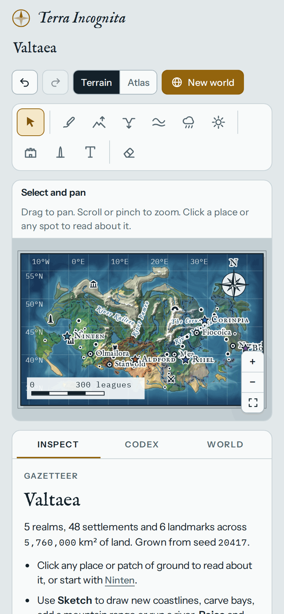
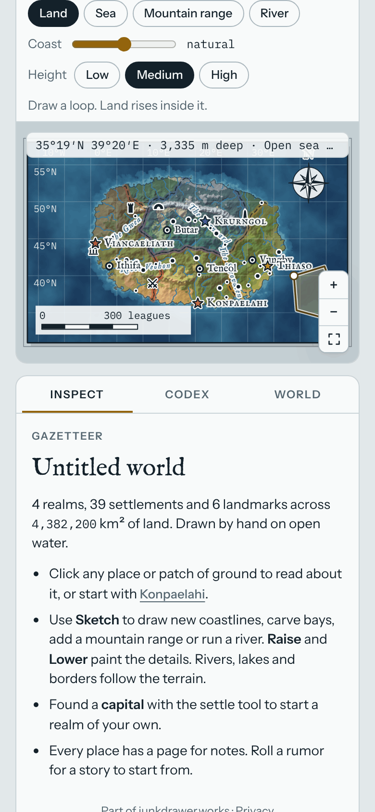
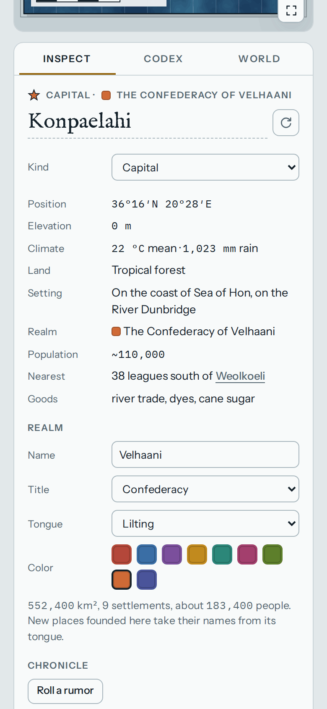

# Terra Incognita

**Play it: [terra-incognita.junkdrawer.works](https://terra-incognita.junkdrawer.works/)**

**Make a map of a world that doesn't exist.** Roll a random world, or start from blank ocean and sketch one yourself:
coastlines, mountain ranges and rivers, drawn with a finger or a mouse. Rain runs downhill, so rivers and lakes form on
their own, the climate decides where forest and desert go, and realms spread out from their capitals until mountains
and sea stop them. Every town has a page for its story.

<p align="center">
  
  &nbsp;
  
  &nbsp;
  
</p>

## How it plays

- **Sketch.** *Land*: draw a loop and land rises inside it, with hills and a coast as smooth or jagged as you like.
  *Sea*: a loop floods, for bays, straits and inland seas. *Mountain range*: draw the ridge line; a valley it blocks
  drains through a gorge at the lowest pass instead of becoming a lake. *River*: draw from the source toward the sea,
  and a valley forms so the water follows your line.
- **Brushes for the details.** Raise, Lower and Smooth reshape the ground; Wetter and Drier move the rain, and the
  forests, grassland and deserts move with it.
- **Water finds its way.** Every patch of ground drains downhill to the sea. Where enough rain gathers there's a river,
  and every river has a name; where water can't get out it pools into a lake.
- **Climate from latitude and height.** Cold in the north, warm in the south, 6.5 °C cooler for every kilometre up, and
  rainfall in millimetres a year. Fourteen kinds of land, from ice sheet to jungle.
- **Realms.** A capital claims the land around it until hills, deserts and sea make going further too costly, and its
  towns push the border out. Each realm has its own tongue, so towns founded inside it sound like they belong there.
- **Places.** Tap any town or patch of ground to see its position, elevation, climate, river, nearest neighbour and
  local goods. Keep notes for your lore, or roll a rumor built from the map around it.
- **Two looks.** Terrain is shaded relief; Atlas is parchment with drawn mountains and trees.
- **No account and no server.** Your world saves itself in your browser. *Save world file* and *Open world file* keep it
  or move it to another device, and *Save map image* makes a picture of it. It works offline and installs to a phone's
  home screen.

## Running it

It's a static site: plain HTML, CSS and JavaScript, with no build step.

```sh
npx serve .                   # or any static file server, then open the printed address
npm test                      # draws a world in Chromium through the real page (needs Playwright)
node tools/screenshots.mjs    # redraws docs/*.png and og.png (needs npm install for upng-js)
node tools/make-icons.mjs     # redraws the PNG icons from icon.svg
node scripts/build.mjs        # writes dist/artifact.html, a single-file copy for Claude's Artifact viewer
```

To put it online with GitHub Pages: **Settings → Pages → Build and deployment → Deploy from a branch**, then pick `main` and `/ (root)`.

### Files

- `index.html`: the page.
- `js/app.js`: the whole app: world generation from a seed, drainage and rivers, climate, realms and borders, names,
  drawing the map, the tools and the panels. `window.terra` is a small hook the test and the screenshots drive it with.
- `css/app.css`: the page, with light and dark palettes.
- `fonts/`: IM Fell English and IM Fell English SC, Instrument Sans, and IBM Plex Mono (all SIL Open Font License),
  served from here so nothing loads from elsewhere.
- `sw.js`: keeps a copy for using offline.
- `scripts/build.mjs`: the single-file copy. Inside Claude, a town's page there can also ask Claude to draft its history
  from the map; on the site that button stays hidden.
- `tools/screenshots.mjs`, `tools/make-icons.mjs`, `tools/icon-full-bleed.svg`: the pictures and icons.
- `test/e2e.mjs`: plays it on a phone-sized screen and a laptop-sized one, and checks it still works offline.
